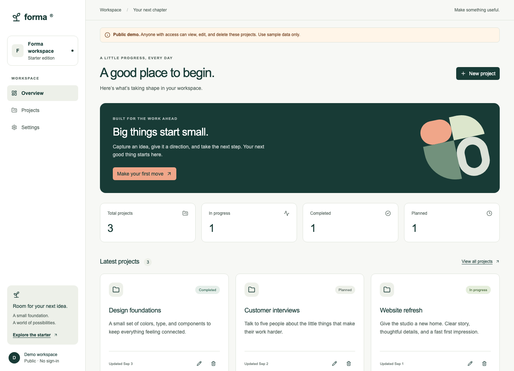

# Cloudflare App Starter

[](https://github.com/kevindrafts/cloudflare-app-starter/actions/workflows/ci.yml)
[](LICENSE)

A focused foundation for dashboards, portals, and SaaS products. **React + Vite + TanStack Router/Query + Hono + D1/Drizzle**, running together on **Cloudflare Workers**.



**[Use this template](https://github.com/kevindrafts/cloudflare-app-starter/generate)** · [Marketing companion](https://github.com/kevindrafts/cloudflare-marketing-starter)

> **Public CRUD demo:** there is no authentication. Anyone with access can read, edit, and delete all projects. Use sample data only. Real user data requires server-side authentication and authorization. Setting `DEMO_MODE=false` disables the demo API; it does not make it private.

## Quickstart

Use GitHub’s **Use this template → Create a new repository**, then clone your copy. To explore this repository directly:

```sh
git clone https://github.com/kevindrafts/cloudflare-app-starter.git
cd cloudflare-app-starter
nvm install
nvm use
npm install --global pnpm@10.34.5
pnpm install --frozen-lockfile
pnpm db:setup
pnpm dev
```

Open **http://localhost:5173**. No Cloudflare account, login, account ID, secrets, or remote database is required. The Cloudflare Vite plugin runs the API in the Workers runtime and persists local D1 data under `.wrangler/state`. Node **24.21.0** is pinned in `.nvmrc` and `.node-version`; another Node manager works too.

`pnpm dev` applies local migrations automatically; `pnpm db:setup` also adds optional, idempotent sample records. Without seeds the app shows its empty state. `.env.example` and `.dev.vars.example` describe optional configuration; no copies are required to get started. Worker variables belong in `.dev.vars`; `VITE_*` variables are public client values.

## What’s included

- Responsive sidebar, mobile navigation, overview, projects, settings, and client-side 404.
- Real D1-backed create/read/update/delete, search, status filters, loading, empty, error, and field validation states.
- Delete confirmation, mutation feedback, browser-persisted theme/density settings, and keyboard-accessible Radix dialogs.
- TanStack Router **client-side routing**, TanStack Query server state, Tailwind CSS, and editable shadcn/ui components with `components.json` for the shadcn CLI.
- Shared Zod input/response contracts, explicit Hono `/api/*` endpoints, Drizzle schema/migrations, and local seed SQL.
- Unit tests plus Playwright API integration and desktop/mobile browser tests against the built Worker and real local D1.
- MIT license, pinned dependencies, pnpm lockfile, GitHub Actions checks, and Workers Builds deployment instructions.

No Next.js, Nuxt, TanStack Start, authentication provider, billing provider, or email service is required.

## Commands

| Command                  | Purpose                                                       |
| ------------------------ | ------------------------------------------------------------- |
| `pnpm dev`               | Migrate local D1 and run Vite + Workers runtime               |
| `pnpm build`             | Build the client and API Worker into `dist/`                  |
| `pnpm check`             | Type-check frontend, shared contracts, API, config, and tests |
| `pnpm test`              | Unit tests, then build + API/browser tests                    |
| `pnpm test:unit`         | Fast contract and API-gate tests                              |
| `pnpm test:e2e`          | Local D1 setup + build + API/browser tests                    |
| `pnpm preview`           | Serve the production build locally on port 5173               |
| `pnpm deploy`            | Validate D1 config, build, deploy                             |
| `pnpm db:setup`          | Local migrations and idempotent seeds                         |
| `pnpm db:migrate`        | Apply local migrations                                        |
| `pnpm db:seed`           | Add local sample records without overwriting edits            |
| `pnpm db:generate`       | Generate a migration from the Drizzle schema                  |
| `pnpm db:migrate:remote` | Explicitly apply migrations to the remote D1 database         |
| `pnpm format`            | Format source files                                           |

Before the first test run: `pnpm exec playwright install chromium` (Linux/CI: add `--with-deps`). Tests start their own production preview and use the local D1 store. They create and clean up their own records and keep the seed fixtures. Stop your development server first for a clean test run; an already-running server can be reused locally. CI always starts a fresh one.

## Project structure

```text
src/
  components/ui/   Editable shadcn/ui Radix + Tailwind components
  components/      App shell, project cards, dialogs
  pages/           Overview/projects and local settings
  lib/             API client, tokens/helpers, local preferences
  main.tsx         Explicit TanStack route tree and Query provider
shared/contracts.ts  Zod inputs and response schemas used on both sides
worker/
  index.ts         Hono API and public-demo gate
  db/schema.ts     Drizzle SQLite schema
drizzle/           Generated migrations
db/seed.sql        Local-only sample data
wrangler.json      Worker, assets, D1 binding, demo variable
```

The API and frontend share one origin. `/api` and `/api/*` run the Worker first, including requests accepting HTML. Unknown API paths return JSON 404s instead of the SPA shell. Other navigation requests use Cloudflare’s SPA asset fallback, so direct links to `/projects` and `/settings` work.

### API contract

| Method | Path                | Result                                                           |
| ------ | ------------------- | ---------------------------------------------------------------- |
| GET    | `/api/health`       | Health and demo mode; no DB query                                |
| GET    | `/api/projects`     | `{ projects: Project[] }`, newest first, up to 200 records       |
| POST   | `/api/projects`     | Create from `{ name, description?, status? }`; 201 `{ project }` |
| PUT    | `/api/projects/:id` | Replace editable fields; 200 `{ project }`                       |
| DELETE | `/api/projects/:id` | 204 with no body; 404 when absent                                |

Names are trimmed, required, and limited to 80 characters. Descriptions are limited to 500. Status is `planned`, `active`, or `done`. Unknown input keys are rejected. JSON errors use `{ error, issues? }`. Writes have an 8 KiB body limit and reject mismatched browser origins. These are basic guardrails, **not authentication or abuse prevention**. The demo refuses new records once its count reaches 200; add transactional quotas/rate limits for a production product.

Settings affect only this browser’s local storage. There is no fictional user account or unimplemented “save profile” endpoint.

## Deploy to Cloudflare

Provisioning and migrations are intentionally explicit:

```sh
pnpm exec wrangler login
pnpm exec wrangler d1 create cloudflare-app-starter-db
```

1. Copy the returned `database_id` into the `DB` entry in `wrangler.json`, replacing the all-zero **local placeholder**. Match `database_name` to the database you created. IDs are resource identifiers, not secrets; never commit API tokens.
2. Change the top-level Worker `name` to a unique name for your project.
3. Decide whether to publish the public demo. `DEMO_MODE=true` permits public CRUD; set it to `false` to disable project endpoints until your authentication/authorization layer exists.
4. Apply the schema and deploy:

```sh
pnpm db:migrate:remote
pnpm check
pnpm deploy
```

Remote seeds are **not** applied automatically. A new deployed database starts empty. Local and remote migration commands are separate to avoid accidental remote changes during development. `pnpm deploy` does not run remote migrations for you and fails helpfully while the database ID is still a placeholder.

After editing `worker/db/schema.ts`, run `pnpm db:generate`, review and commit the SQL plus Drizzle metadata, test with `pnpm db:migrate`, then explicitly apply the migration remotely before the corresponding deployment. Prefer backward-compatible migrations for rolling deployments. Local changes never migrate the remote DB by themselves.

### Workers Builds (recommended continuous deployment)

First provision D1 and apply the remote migration above. Connect **your copied GitHub repository** in Cloudflare Workers & Pages, production branch `main`, root `/`, with a Worker name matching `wrangler.json`.

| Setting                       | Value                                                        |
| ----------------------------- | ------------------------------------------------------------ |
| Build command                 | `pnpm install --frozen-lockfile && pnpm check && pnpm build` |
| Deploy command                | `node scripts/check-deploy.mjs && pnpm exec wrangler deploy` |
| Build variable `NODE_VERSION` | `24.21.0`                                                    |
| Build variable `PNPM_VERSION` | `10.34.5`                                                    |

The Cloudflare Vite plugin generates the deployment configuration; Wrangler discovers that build output automatically. GitHub Actions runs checks/tests without Cloudflare credentials. Workers Builds handles deployment after its GitHub integration is connected in your own account. Cloning the template does not connect an account or provision a database.

Keep remote migrations an explicit release step. If you later automate them, use a narrowly scoped token with D1 permission and review schema changes first. Do not run pull-request previews against a production database: configure an isolated preview D1 binding and migrate it before enabling preview deployments. Add your domain, such as `app.example.com`, in the Worker’s **Settings → Domains & Routes**.

## Customize

- Change colors in `src/styles.css`: `:root` defines the default palette, `:root.dark` overrides it, and `@theme inline` exposes Tailwind utilities. Core UI, hero artwork, status badges, the demo notice, and dialog overlays all use named tokens. Shared accents inherit the base palette in dark mode unless overridden. The browser theme color follows the current `--primary`.
- Use semantic classes such as `bg-accent`, `text-status-active-foreground`, and `border-notice-border`; avoid color literals in components. Add new tokens in the palette and Tailwind mapping when needed.
- Replace Forma branding in `Shell.tsx`, page copy, and `index.html`. The favicon template is `scripts/assets/favicon.svg`; `pnpm brand:generate` renders it from the base palette before dev/build. Rerun that command after editing colors during a dev session, keep asset-referenced tokens as literal hex colors, and commit the generated favicon.
- Add UI components using `pnpm dlx shadcn@latest add <component>`; `components.json` and the `@/` alias are ready. Existing small components are owned and editable in your repo.
- Add client routes explicitly in `src/main.tsx`. No full-stack router framework is involved.
- Add server routes in `worker/index.ts`, and shared validation in `shared/contracts.ts`.
- Update the schema and generate migrations instead of modifying a live DB manually.

## Optional integrations

**Better Auth:** add it deliberately when you need accounts. Follow the current [installation and Cloudflare Workers guidance](https://better-auth.com/docs/installation), store its secret with `wrangler secret put`, add auth routes under `/api/auth/*`, and validate the session on the Worker. Add an owner/user ID to records and scope **every** list, update, and delete to that identity. Replace the public demo gate; a client-side route guard alone is not access control. Include unauthorized and cross-user access tests.

**R2 uploads:** add an R2 binding when needed. Authenticate uploads/downloads, check ownership, constrain object sizes/types, and store object keys in D1. Decide whether files should be public or served through authorized Worker routes. See [R2 Workers API](https://developers.cloudflare.com/r2/api/workers/workers-api-usage/).

Billing, transactional email, queues, and AI remain outside the core. Add only what your application needs.

## Two repos, two deployments

```text
example.com       → Astro marketing starter (static HTML)
app.example.com   → this repo: React assets + Hono /api/* + D1
```

There is no shared runtime, mandatory monorepo, or app code shipped to marketing visitors.

## References

- [Cloudflare: React + Vite](https://developers.cloudflare.com/workers/framework-guides/web-apps/react/)
- [Cloudflare Vite plugin](https://developers.cloudflare.com/workers/vite-plugin/)
- [D1 migrations](https://developers.cloudflare.com/d1/reference/migrations/)
- [Workers Builds configuration](https://developers.cloudflare.com/workers/ci-cd/builds/configuration/)
- [TanStack Router](https://tanstack.com/router/latest/docs/framework/react/overview)
- [shadcn/ui](https://ui.shadcn.com/docs)

See [CONTRIBUTING.md](CONTRIBUTING.md), [SECURITY.md](SECURITY.md), and [MIT license](LICENSE).
